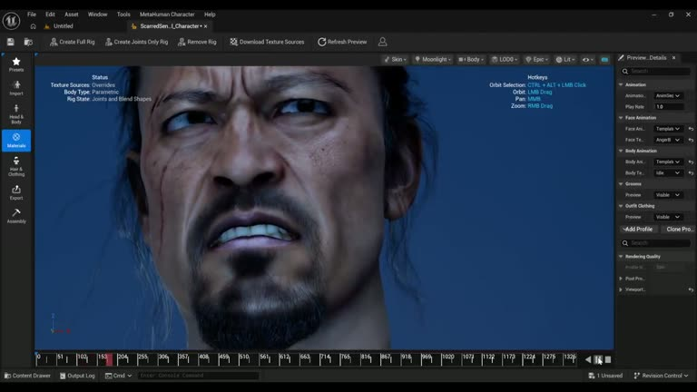

## Summary
MetaHuman Maker by TREE Industries ([github.com/TREE-Ind/MetahumanMaker](https://github.com/TREE-Ind/MetahumanMaker)) is an open-source (MIT) Blender add-on that turns photos or source meshes into editable MetaHuman characters for Unreal Engine: wrap and fit the head and body, sculpt and repair regions, rebuild missing skin detail with up to 8K textures, then send rigs and grooms into Unreal. An AI agent can drive the same tools through Blender MCP. Joshua Johnson (@joshuajohnsonAI) posted it saying he context-engineered it so the agent gets better with every character you ask it for. Windows x64, Blender 5.2, Unreal 5.8; preview release v0.346.0.

Video frame (69s demo in the Unreal MetaHuman Character editor): close-up of a snarling, scarred middle-aged man with tied-back black hair and a goatee on a blue background, with the editor's Create Full Rig / Joints Only Rig buttons and a Preview Details panel (animation, face and body animation, grooms, outfit). Other frames zoom into very fine pore-level skin texture on the cheek and nose.

## Raw
https://x.com/joshuajohnsonai/status/2122836076515799287?a=tpNaFMTm4-1G6dSP2vc&s=46

## Notes
Related: [[blender-mcp-storybook-hero-workflow]] (another agent-driven Blender character workflow).
