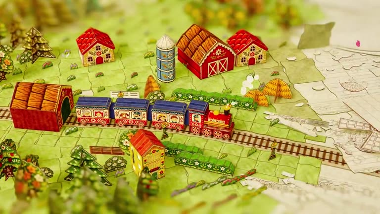

## Summary

Papercraft by Shikhar (@xikhar) is an agent skill (Claude Code, Codex, Cursor, Gemini CLI...) for building games, interactive scenes, web pages, animations and videos in one pop-up papercraft style: printed cardstock pieces with thin cut edges that fold up on hinges, soft shadows tinted by the world, a tilt-shift macro lens and soft paper sounds. It carries the numbers from a shipped three.js pop-up game, a set of piece types (folded boxes, domes, bridges, printed water) and a `capture.py` that renders stills and MP4s at reel, square and 4K sizes. The post shows "The paper rails", a three.js train world made with Opus 5.5 and the skill.

The frame shows a paper toy train with blue carriages and a red engine, covered in folk-art flower prints, running past red-roofed paper houses, a silo and paper pine trees on a tiled green ground. Other frames show the train crossing an arched paper bridge over a teal river, a close-up of the engine with a cartoon driver, and a night version of the town with glowing windows and street lamps.

## Raw
https://x.com/xikhar/status/2126470165609222301?a=Bsc7z2xLb-57VfY6-VY&s=46

## Notes
- Install: `npx skills add xikhar/papercraft`. Repo: https://github.com/xikhar/papercraft
- Post text: "The paper rails. Opus 5.5 + three.js. Also so happy to see many people use papercraft to build things."
- [[cinematic-film-skill]]: another agent skill that turns a prompt into a finished, styled film
- [[pixel-art-gaussian-splats]]: also small AI-built 3D diorama worlds with one strong look
- [[munde-mode-game]]: same warm toy-diorama 3D feel I'm going for there
