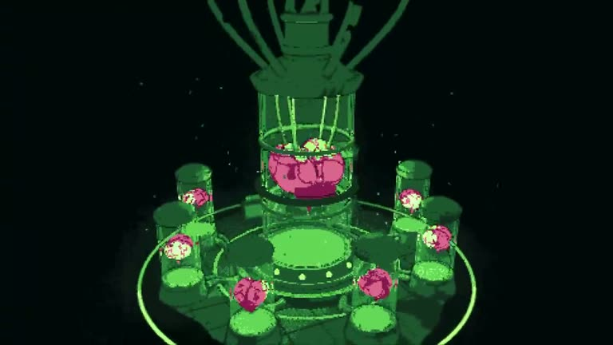

## Summary
Silicon Jungle (@JungleSilicon) shows small 3D scenes rendered as pixel-art gaussian splats, which keep a crisp pixel-art look while the camera orbits around them. The author says they were made with Fable 5.2. The 36-second video cycles through floating dioramas on black: a vine-covered stone hand with one eye inside a ruined arch, a green lab with glass vats holding pink brains, a witch's hut in a swamp with warm orange windows and reeds, and an icy blue dragon skeleton curled around a candle-lit shrine. Each scene sticks mostly to one hue with a single accent colour.

The frame shows the green lab: a tall central glass tank with a pink brain, ringed by smaller vats on a glowing circular platform.

## Raw
https://x.com/JungleSilicon/status/2121782359901212987

## Notes
Related: [[sprite-stacking-pixel-art]] (another way to give pixel art a 3D turn).
