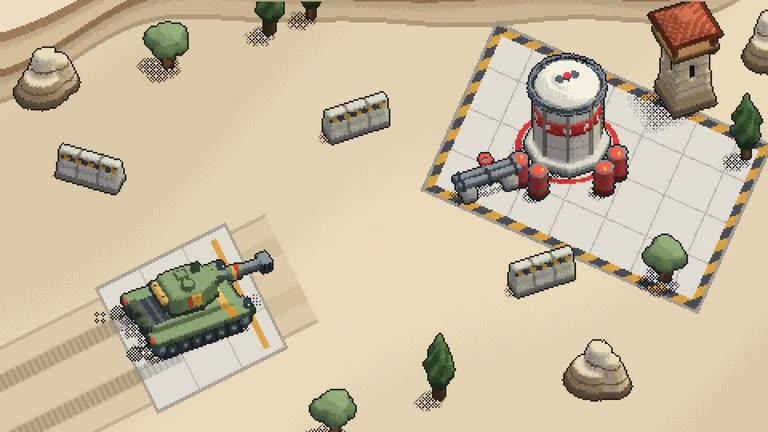

## Summary
Daniel White (@dwhitedesign) shows a top-down pixel-art tank scene with a shockwave where "there is zero 3D": everything is flat 2D pixel layers stacked and drawn on a plain HTML canvas. The code is open source at github.com/danielwh2/sprite-stacking and also installs as an agent skill (`npx skills add danielwh2/sprite-stacking`) that turns a sprite's top, side, front and back views into a stacked, rotatable 3D-looking sprite.

The frame shows a green pixel tank on a hazard-striped pad on sandy ground, with barriers, round rocks, little trees, a watchtower and a white turret base ringed with red barrels, all with dotted halftone shadows.

## Raw
https://x.com/dwhitedesign/status/2125590316539621606?a=kZFpVos9GQj0urqXkz0&s=12

Note: Game art style

## Notes
- [[sprite-stacking-pixel-art]]: same technique, this one is a ready canvas library and agent skill
- [[lastmaglab-top-down-shooter]]: another top-down shooter look with chunky props
- [[pixel-art-gaussian-splats]]: also pixel art that looks 3D
