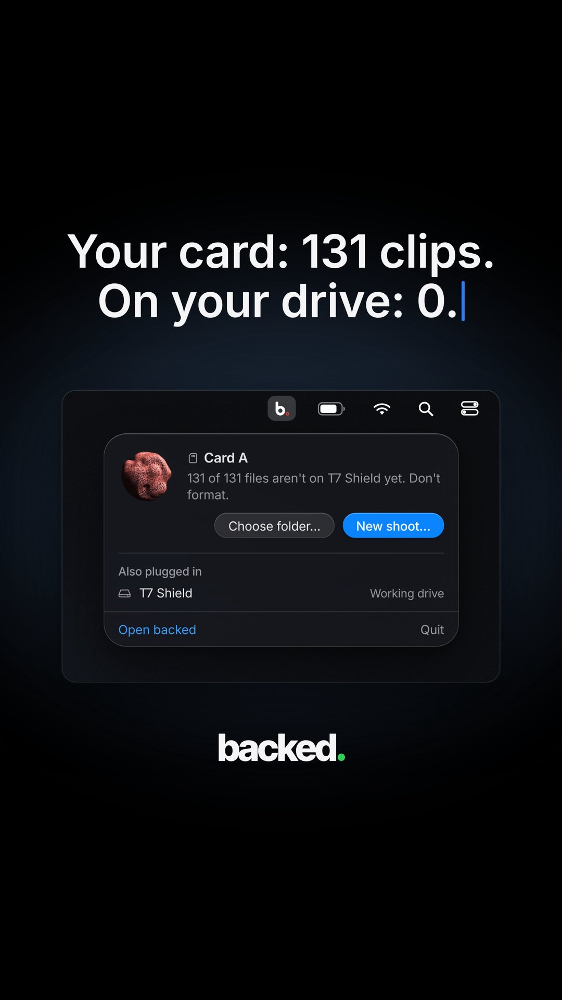

## Summary

Idea for a PXLVZN app: a data-transfer checker for DIT (card offloads) on shoots, so nobody formats a card before every clip is safely on the drive. Sparked by **backed**, a Mac menu bar app that compares a camera card against the working drive, shows what's missing ("131 of 131 files aren't on T7 Shield yet. Don't format."), copies only the missing clips into the right shoot folder and verifies every clip.

The image is backed's promo: a dark menu bar popover for "Card A" with "Choose folder..." and a blue "New shoot..." button, the T7 Shield listed as the working drive, headline "Your card: 131 clips. On your drive: 0."

## Raw
https://www.instagram.com/reel/DfkvaoETdCl/?exln=MWd3YWlueW5peWR3bg==

App idea for PXL, it can be a data transfer system checker, like whenever I'm like DIT is happening on a shoot or something, this app can be used.

## Notes
- Reference app: backed (@backed_app), early access via comments. Caption: "See what's missing before you copy a thing. Then backed copies just that into the right shoot folder and checks every clip."
- Related PXLVZN file tools: [[2026-11-12-hop-file-transfer]], [[2026-11-12-ferry-file-manager]]
- Label: [[2026-11-12-pxlvzn-label]]
