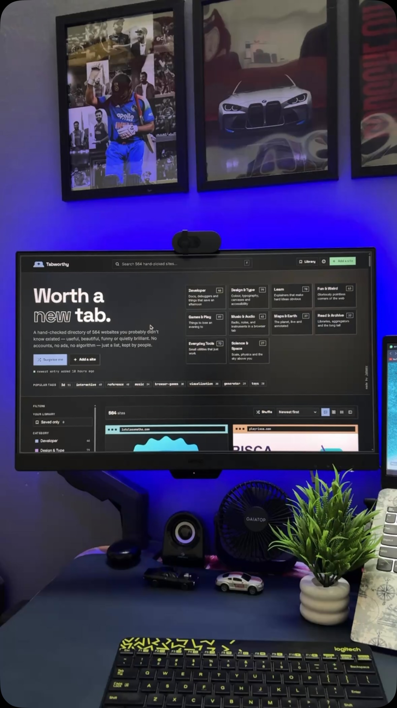

## Summary

A reel by @prafull_codes showing Tabworthy, a hand-checked directory of about 564 websites "you probably didn't know existed": useful tools, AI resources, developer utilities, browser games and odd finds, with no accounts, ads or algorithm. The dark homepage reads "Worth a new tab." with a "Surprise me" button, a search bar, and category cards (Developer, Design & Type, Learn, Fun & Weird, Games & Play, Music & Audio, Maps & Earth, Read & Archive, Everyday Tools, Science & Space), popular tags like 3d, interactive, browser-games and visualization, plus a saved library and shuffle. The site URL isn't shown in the reel.

## Raw
https://www.instagram.com/reel/Df9qNfxxuuu/?knvt=YTJ2cWEyNDhuYmZt

## Notes
- Caption: "The internet is full of hidden gems, and Tabworthy helps you discover them! Explore 500+ curated websites featuring useful tools, AI resources, developer utilities, browser games, and some seriously unique finds."
- Related: [[2026-11-12-perfolios-portfolio-directory]]
