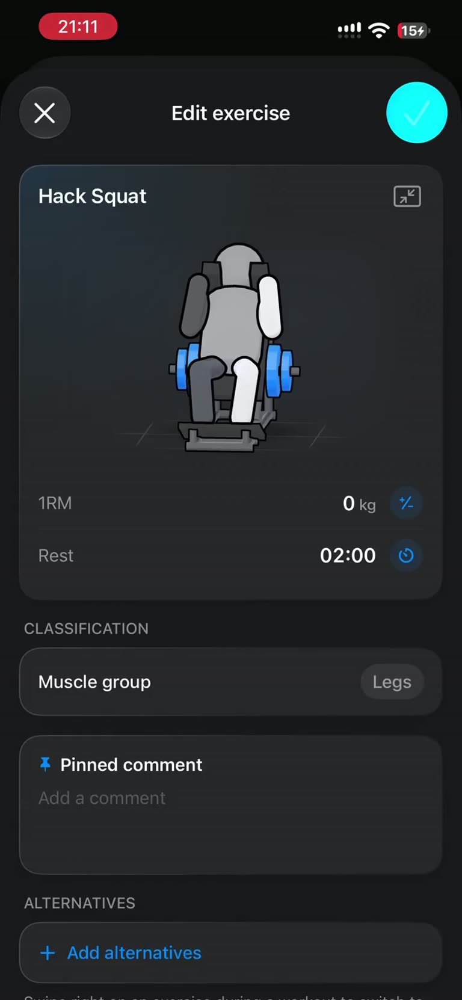

## Summary
Konstantin's thread on how his iOS workout app shows a small 3D figure for each of 80 exercises in about 200 KB total (1-3 KB each). He doesn't ship video, frames or 3D models: an in-house generator turns each exercise definition into a tiny file describing only the movement, and a native MetalKit renderer draws the scene live on the device. Because it's real geometry, you can rotate the camera freely and it stays sharp at any size; the heavy part (the renderer) ships once.

Frame: the dark "Edit exercise" screen for Hack Squat, with a big card showing a chunky grey mannequin with one white arm and leg sitting in a hack squat machine with blue plates. Other frames show the exercise catalog, where each row's icon is the same little figure doing the move (lateral raise, pec deck, skull crusher).

## Raw
https://x.com/kostyabash/status/2126234542465863797?a=FBmfyq7s3cvlRW3Pq6Q&s=46

## Notes
- [[bulkbros-gym-app]]: my gym app could show exercises with tiny 3D figures like this
- [[native-swift-app-tip]]: another native iOS build tip
