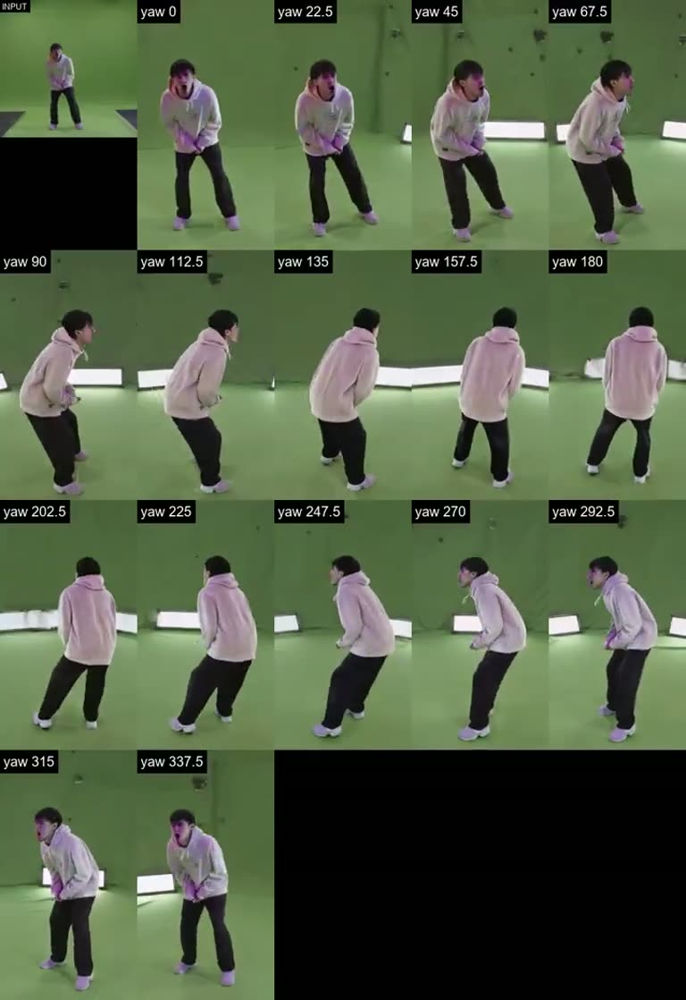

## Summary
Kotaro Nogami's tech test of 4D Gaussian Splatting (4DGS): from one single video of a person, ComfyUI's SplatKit builds a 3D Gaussian splat for every frame, so the performance becomes a moving volumetric capture you can view from any angle. The post text is in Japanese and was cut off after that sentence.

First video: a contact sheet with the small INPUT clip (a guy in a pink hoodie and black trousers dancing on a green-screen stage) and the same frame rendered from 16 camera angles, yaw 0 to 337.5 in 22.5° steps, front, side and back all filled in. Second video: the splat sequence loaded in Blender, played back from a moving "360 Handheld" camera on the grey viewport grid.

## Raw
https://x.com/kotarounogami/status/2125796486147707129?a=pZCTE87Q5ie-3vQmw7k&s=20

## Notes
- [[pixel-art-gaussian-splats]]: Gaussian splats again, there as a pixel-art look
- [[ladybug-vfx-app]]: another AI VFX trick on real footage
