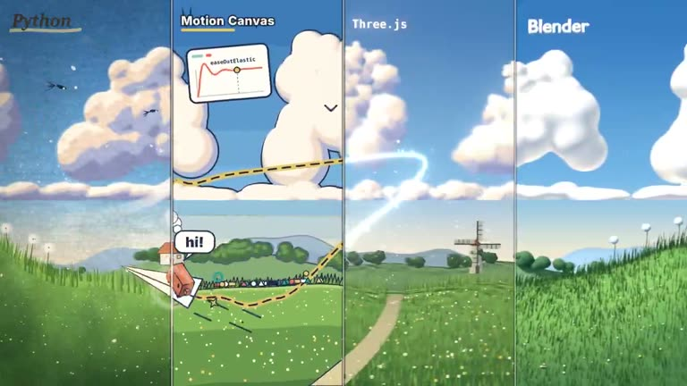

## Summary
Mimo (@aura_uniiiii) renders the same scene (a grassy hill, path, windmill, clouds and a flying paper plane) four ways with Claude and plays them side by side, to show that the tool you pick decides whether a code-made video looks like an animated film or a slideshow:

1. **Python**: free-form style, can do a hand-drawn texture; good for art animation, maths demos and data viz.
2. **Motion Canvas**: clean frames and smooth easing; good for explainers and tech tutorials. Remotion (React) is the sibling for batch-making templated videos.
3. **Three.js**: real-time web rendering; best for interactive 3D scenes and immersive effects.
4. **Blender**: full 3D modelling and rendering; film-grade lighting, camera moves and product shots, but the slowest to render.

Frame: four vertical strips labelled Python, Motion Canvas, Three.js and Blender. Python is a grainy painterly meadow with birds; Motion Canvas is flat cartoon with a dashed flight path, an easeOutElastic curve card and a "hi!" speech bubble; Three.js is a soft 3D field with a glowing light trail; Blender is the cleanest 3D with chunky white clouds and dense grass. A follow-up post teases "11 more worlds coming, made entirely with code" with a pixel character.

## Raw
https://x.com/aura_uniiiii/status/2126107363191234774?a=VYQFk7KCgfUUMy2VlIg&s=20

## Notes
- [[raea-render-engine]]: agents writing code that renders video, motion graphics and 3D
- [[cinematic-film-skill]]: a Claude skill for explainer-style motion video
- [[escapement-blender-short-film]]: the Blender route taken all the way to a short film
