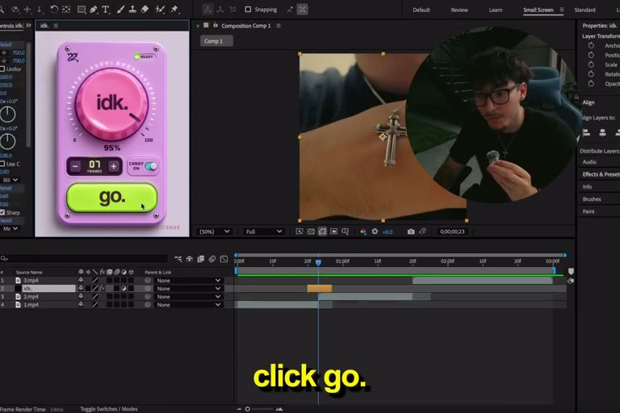

## Summary
A reel by @22francc selling "idk.", an After Effects tool that builds a transition for you: you set an intensity dial and a frame count, hit "go.", and it drops a stack of pre-keyed layers (type cutout, shape stamps, pixel window, crop, white flash) between two clips. Hit "go." again for a different one. Saved as an idea for a similar one-click plugin for After Effects and Premiere Pro.

The frame shows After Effects with the plugin panel on the left: a lilac rounded panel with a big glossy pink "idk." knob at 95%, a "06 frames" stepper, a "candy on" toggle and a lime-green "go." button, and the timeline full of generated idk.* layers. Caption: "LINK IN BIO TO COP IT, LIMITED TIME SALE, #explore #editor #ae".

## Raw
https://www.instagram.com/reel/DgNBSZoP1or/?lqvp=MTE0dmpkNzBvYzl5Mw==

Note: Plugin idea for ae/pr

## Notes
- [[frame-tracker-dashboard]]: my other Premiere Pro and After Effects plugin
- [[dit-offload-checker-idea]]: another tool idea for my editing workflow
